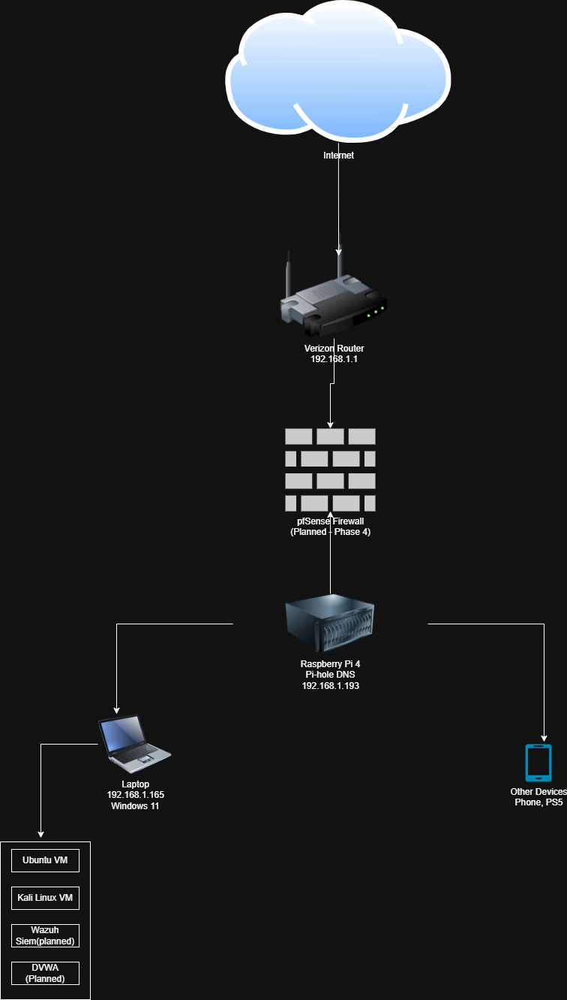

# Setting Up a Home Lab

## Network Topology

## Overview
This repository documents my home lab project covering 
virtual machine setup, network design, and security tooling. 
It is built as a hands-on cybersecurity portfolio to 
demonstrate practical skills in networking, virtualization, 
and security monitoring.

## Tools & Technologies
- Oracle VirtualBox
- Ubuntu Linux
- Kali Linux
- Raspberry Pi 4
- Pi-hole DNS Filter
- pfSense Firewall
- Wazuh SIEM
- DVWA

## Documentation

| Guide | Description |
|---|---|
| [Ubuntu VM Installation](ubuntu-vm-install.md) | Step-by-step guide to installing Ubuntu on VirtualBox |
| [Pi-hole Setup](pihole-setup.md) | Setting up Pi-hole on Raspberry Pi 4 |
| [Wazuh SIEM Setup](wazuh-setup.md) | Deploying Wazuh SIEM and custom detection rules mapped to MITRE ATT&CK |
| [pfSense Firewall Setup](pfsense-setup.md) | Configuring pfSense as a network firewall |
| [DVWA Setup & Attack Simulation](dvwa-setup.md) | Installing DVWA, simulating a brute force attack, and identifying a Wazuh detection gap |

## Project Status
🔄 In Progress — core infrastructure (VM setup, Pi-hole, Wazuh, pfSense, DVWA) complete; closing the Apache log detection gap and expanding attack simulations are next

## Author
OlamideB